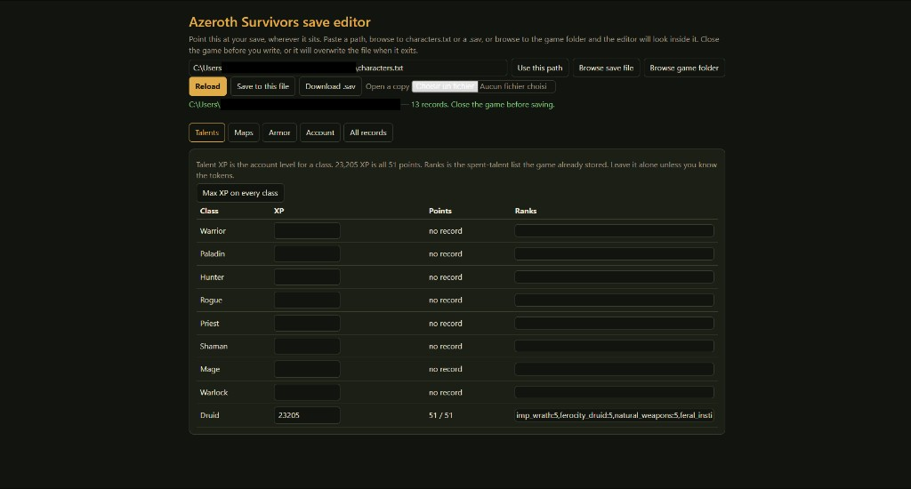

# Azeroth Survivors save editor

A local editor for the Windows Azeroth Survivors account save. It can raise talent XP, mark maps cleared, unlock armor, and change stats, codex, achievements, or any other record. It writes a signed `RSE1` file the game will load.



## Run it

You need [Node.js](https://nodejs.org). Then double-click `Open Save Editor.bat`, or from this folder:

```
node server.js
```

The page opens at [http://127.0.0.1:8734/](http://127.0.0.1:8734/).

## Point it at your save

The save is usually `%APPDATA%\wenilla-rogue\characters.txt`, but it can live anywhere. In the editor:

- paste the path to `characters.txt`, a `.sav`, or the game folder, then click **Use this path**
- **Browse save file** and pick the file
- **Browse game folder** and let it look inside

The chosen path is remembered in `hooked-save.txt` next to the editor (that file is not committed). **Save to this file** writes only that path. Close the game first, or it will overwrite the file when it exits. Each write keeps a timestamped backup beside the save.

**Download .sav** is for in-game **Options → Saves → Import Save**.

Talent XP in this save is the account talent tree, not the XP bar inside a run.
